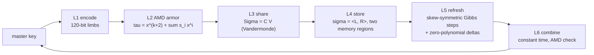

# CAIRN

**Information-theoretic, leakage-resilient threshold custody of master keys, built from nothing but linear algebra over the Mersenne field GF(2^127 - 1).**

One stone of a cairn says nothing; enough stones mark the way. CAIRN splits a master key into `n` shares so that any `t` recover it, and then closes the five windows through which a shared key still leaks in practice:

| Window | What goes wrong with textbook Shamir | CAIRN layer | Guarantee (proved in the [paper](paper/cairn.pdf)) | Evidence |
|---|---|---|---|---|
| **At rest** | stolen share files | Vandermonde sharing | `t-1` shares are independent of the key (perfect secrecy) | exhaustive enumeration, 0 violations in 77,525 dealings |
| **Over time** | a patient attacker collects `t` shares over months | zero-polynomial proactive refresh | a mobile adversary learns nothing | `attacks/mobile_adversary.py` |
| **In memory** | cold boot, swap, partial memory disclosure | split-state storage `sigma = <L, R>` | advantage `<= 5 * 2^-128` under 378 bits of arbitrary leakage from a share (32-byte key) | exact leakage tables |
| **During reconstruction** | timing and cache side channels | constant-time combine | no secret-dependent branch, address or latency | dudect `max|t| <= 2.1` (naive: 12,670), ctgrind, assembly audit |
| **Under manipulation** | a cheating custodian steals the key (Tompa-Woll) | AMD armor | wrong key accepted with probability `<= (k+1)/p ~ 2^-125` | exhaustive and tight over 21.4 M secret/error pairs |

**No computational assumption anywhere.** No AES, no hash function, no discrete logarithm, no pre-existing cipher of any kind. Every guarantee is an unconditional theorem with an explicit bound, so there is nothing to brute-force and nothing that a future quantum computer changes.



## Try it (60 seconds)

```console
$ cargo build --release
$ alias cairn=target/release/cairn

# A fresh 32-byte key that is never printed and never touches the disk:
$ cairn split -t 3 -n 5 --generate 32 -o shares/
cairn: wrote 5 shares (any 3 recover the secret) to shares  set 3f9c2a...

# Proactive refresh: every share changes, the key does not, old shares die.
$ cairn refresh shares/share-*.cairn
cairn: refreshed 5 share(s) to epoch 1

# Use the key without ever writing it down: it goes to a program over a pipe.
$ cairn combine shares/share-1.cairn shares/share-4.cairn shares/share-5.cairn --exec sha256sum
cairn: integrity verified; recovered with shares 1, 4, 5

# Custodian 1 cheats by altering one byte of her share.
$ printf '\x01' | dd of=shares/share-1.cairn bs=1 seek=700 conv=notrunc status=none
$ cairn combine shares/share-{1,2,3}.cairn --exec true
cairn: error: integrity check failed: shares were tampered with or are inconsistent

# With a fourth share present, the key is recovered and the cheater is named.
$ cairn combine shares/share-{1,2,3,4}.cairn --exec true
cairn: integrity verified; recovered with shares 2, 3, 4
cairn: WARNING inconsistent share(s): 1 (tampered, forged or stale)
```

Other commands: `cairn refresh --deltas-out DIR` for custodians who are not present, `cairn apply-delta`, `cairn rerandomize` (local re-randomisation of the storage), `cairn inspect`. The binary disables core dumps and `ptrace`, locks secret memory, writes shares with mode `0600`, never overwrites, and refuses to print a key to a terminal.

## The mathematics in one screen

* **Field.** `p = 2^127 - 1`. Since `2^127 = 1 (mod p)`, reduction is a shift and an add; inversion is `x^(p-2)` with a public exponent. No division instruction is ever executed on secret data.
* **AMD armor** (Cramer et al. 2008). `a = (s_1..s_k, x, tau)` with `tau = x^(k+2) + sum s_i x^i`. Any error the cheaters add is independent of `x`, and a non-zero error turns acceptance into a non-zero polynomial equation of degree at most `k+1` in `x`.
* **Sharing.** `Sigma = C V` with `V` Vandermonde. Any `t-1` columns of `V` (without the constant row) have full rank, so the shares are uniform whatever the key.
* **Split-state storage.** Each share coordinate is stored as `(L, R)` with `<L, R> = sigma`. By Lindsey's lemma the inner product is a two-source extractor; our self-contained proof gives advantage `<= (1 + 1/p) 2^((lambda_L + lambda_R)/2) p^(-(ell-3)/2)`.
* **Refresh.** For a skew-symmetric `A`, `<A R, R> = 0`, and `A -> A R` is onto `R^perp`. So `L += A R; R += B L; L += C R` is a sequence of exact Gibbs steps that never computes `sigma` and never inverts anything.
* **Our own cryptanalysis found a real break** in the natural *two*-step refresh: the new `L` still satisfies `<L_new, R_old> = sigma`, so one memory dump before and one after a refresh reveal the value. The third step reduces the advantage to exactly `p^-(ell-1)`, which we prove and confirm to every printed digit.

## Evidence: run it yourself

```console
$ make verify      # everything below, then rebuilds the paper from the fresh results
```

| Check | Command | Result |
|---|---|---|
| Unit, property and tamper tests | `make test` | random edits of share files never yield a wrong key |
| Independent reference implementation | `make kat` | Python spec and Rust produce **byte-identical** shares, before and after refresh |
| Exact perfect secrecy | `cairn-lab secrecy` | 0 violations, every dealing enumerated |
| Exhaustive AMD bound | `cairn-lab amd` | worst case equals the bound `(k+1)/p` exactly (tight) |
| Cross-epoch refresh leakage | `cairn-lab refresh` | 2-step: TV = 1 (break); 3-step: TV = `p^-(ell-1)` exactly |
| Split-state leakage | `cairn-lab leakage` | one half alone: 0; both halves fully read: 1 |
| Timing (dudect) | `cairn-lab dudect` | CAIRN `max|t|` <= 2.1; textbook baseline up to 12,670 |
| ctgrind (Valgrind) | `make ctgrind` | memcheck sees no secret-dependent branch or address |
| Assembly audit | `make asm` | field ops: 0 conditional jumps, 0 divisions |
| Undefined behaviour | `make miri` | 35/35 core tests pass under Miri |
| Attacks | `make attacks` | Tompa-Woll steals the key from plain Shamir, fails on CAIRN; mobile adversary fails |

Numbers above come from `results/*.json`; the paper's tables and figures are generated from the same files.

## Repository

```
crates/cairn-core   no_std, unsafe-free Rust: field, encoding, AMD, sharing, storage, refresh, combine, format
crates/cairn-cli    the `cairn` tool (the only unsafe code: four audited libc calls for hardening)
crates/cairn-lab    exhaustive proofs, leakage analysis, dudect, ctgrind, benchmarks
crates/cairn-naive  deliberately vulnerable textbook baseline (attack target only)
reference/          executable specification in Python + known-answer vector generator
attacks/            Tompa-Woll and mobile-adversary demonstrations against the real binary
paper/              LaTeX paper, figures and tables generated from results/
tools/              ctgrind, assembly audit, house-style checks
```

## Threat model and limitations

CAIRN trusts the dealer while it deals and the combiner while it combines (the combiner outputs the key, by definition). It requires the combiner to know which custodian holds which share index (a roster): we prove that **no** keyless scheme can avoid this. The leakage theorem covers storage; the computation that joins both halves is protected by constant-time code and measurement rather than by a leakage theorem. We did not measure power or electromagnetic emanations on hardware. Full list in the paper, Section 8.

## License

MIT. See [LICENSE](LICENSE).
